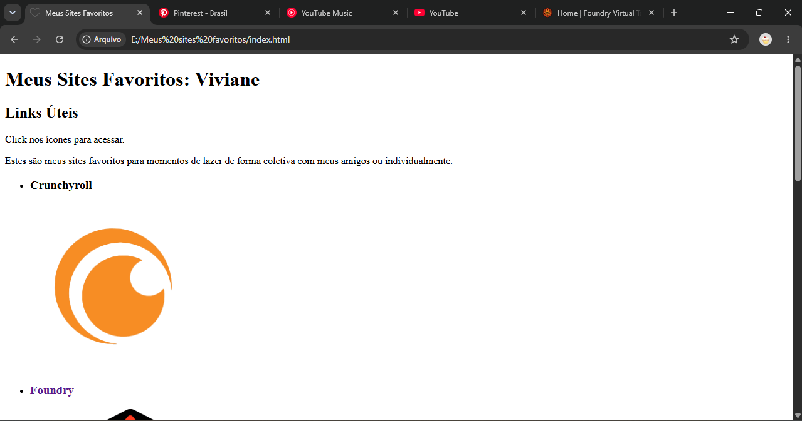
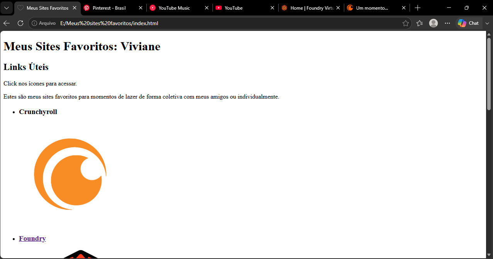

# 💖 Meus Sites Favoritos

Uma página web simples que reúne alguns dos meus sites favoritos para acessar durante momentos de lazer, individualmente ou com amigos.

O projeto foi desenvolvido como atividade prática da disciplina **Desenvolvimento de Sistemas 1**, com o objetivo de exercitar a estruturação de páginas web e a organização de links e imagens em HTML.

## 🖥️ Tecnologias Utilizadas

  

- **HTML5** — estruturação do conteúdo da página.
- **CSS3** — estilização da interface, caso aplicado no projeto.
- **Visual Studio Code** — editor utilizado no desenvolvimento.

##  Prévia do Projeto

###  Google Chrome

###  Microsoft Edge

## 🎓 Sobre

Projeto acadêmico desenvolvido para praticar conceitos introdutórios de desenvolvimento web.
